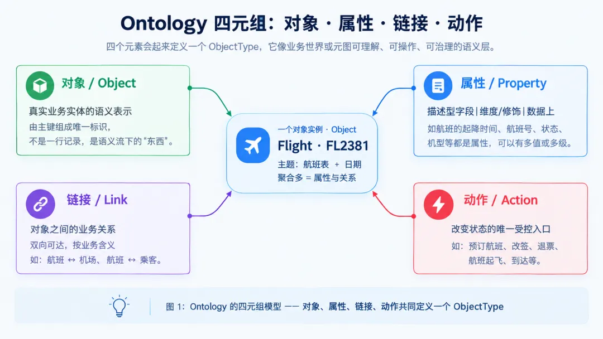
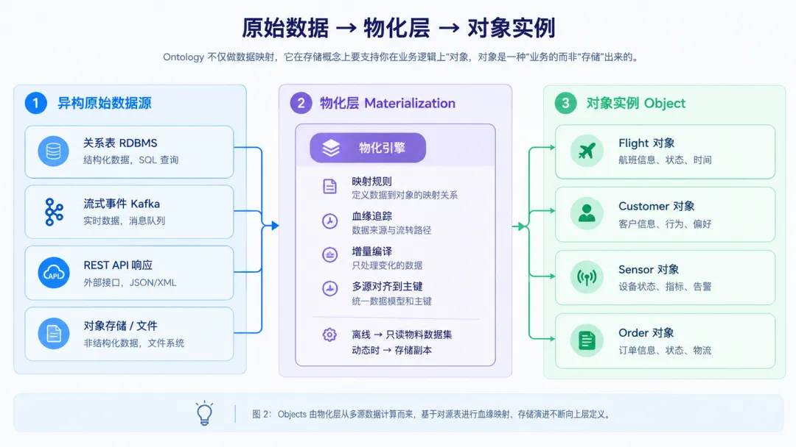
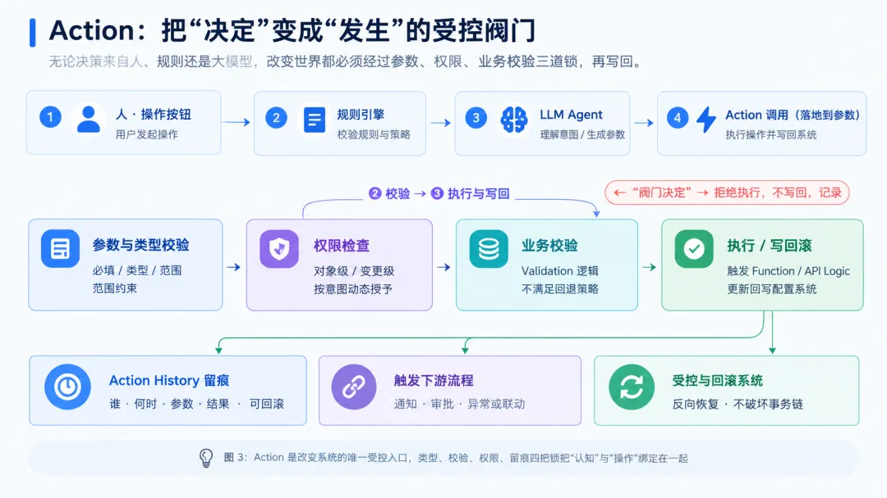
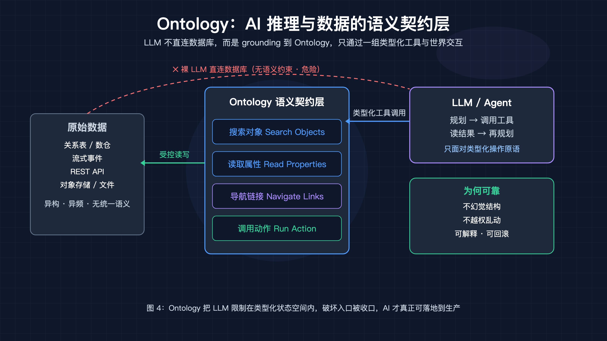

# Ontology：Palantir 架构真正的核心，不是数据库也不是知识图谱

> 来源：[腾讯云开发者社区 · 原文](https://cloud.tencent.com/developer/article/2739430)
> 作者：老周聊架构　|　发布于 2026-09-08 20:41:17
> 说明：全文与配图均按原文保留，配图存于同级 `images/` 目录。

---

聊 Palantir 这套东西，大多数人陷入的第一个误区就是拿自己熟悉的东西去套。看完 Foundry 的管线，会觉得它不过是个数据平台。看完 Gotham，会觉得这不就是个知识图谱吗。看完 AIP 怎么让大模型调工具，又觉得这跟 LangChain 接几个 function 差不多。

这些类比都不是错的，但每一个都漏掉了最关键的那一层。Palantir 在 2018 年前后把所有产品线统一到一个概念上，叫 Ontology，中文一般翻成「本体」。你可能听过这个词，觉得玄乎，像哲学名词。但在 Palantir 的工程语境里，它非常具体，指的就是一套运行在生产环境、每天支撑上亿次读写、直接决定大模型能不能可靠行动的语义层。

我的看法很直接：如果你没理解 Ontology，你就没理解 Palantir 为什么值那么多钱，也没理解他们讲了好几年的「AI 落地到决策」到底靠什么撑着。这一篇，我们就把这个最核心、也最容易被当成背景板的东西拆开来讲透。

先给一个结论性的定义，后面再展开。Palantir **Ontology** 是一层放在「原始数据」和「应用 / AI 推理」之间的**语义契约层**。它不存业务数据本身，但它定义了业务世界里有哪些实体（对象）、这些实体长什么样（属性）、彼此怎么连（链接）、能对它们做什么（动作）。所有上层应用、所有 Agent、所有写回操作，都必须通过这层契约来进行。

## 它首先不是什么

先排雷。我把最常见的三种误会逐一说清楚。

**不是数据库**。Ontology 不持有你的记录行。它背后确实挂着数据，但那些表、那些流、那些 API 响应，仍然待在它们原本的地方：Oracle、Snowflake、Kafka、Salesforce、甚至是某一堆 S3 上的 CSV。Ontology 做的是在它们之上「**物化**」出对象。你查一个 Customer 对象，拿到的属性值是从底层源实时算出来的，不是从一张叫 Customer 的表里直接 SELECT 出来的。这一点后面会专门讲 materialization，它是整个设计的命门。

**不是普通的知识图谱**。知识图谱的核心是「节点 + 边 + 属性」，本质是在做关系的存储和推理，典型如 Neo4j 或者 Google 的 Knowledge Graph。Ontology 有「对象」也有「链接」，看起来像，但有两个根本性差别。第一，它的链接不是为了图遍历推理，而是为了表达业务语义上的归属与关联，并且链接是可以带方向、带约束、被权限系统精细控制的。第二，也是最重要的，知识图谱通常是只读的分析视图，而 Ontology 是**可写的、可执行行为的**。它内置了 Action 这个东西，能真正改变世界的状态，而不只是描述世界。

**不是 ORM，也不是 schema 的别名**。这是工程师最容易犯的错。你会想，对象、属性、链接，这不就是领域模型加外键吗？差得远。ORM 解决的是「对象怎么映射成表」，而 Ontology 解决的是「一个跨十几个异构系统的真实实体，怎么在应用面前表现为一个统一的、可操作的东西」。ORM 不管权限，不管实时物化，不管「让大模型安全地调用一个能改生产数据的函数」这种事。

一句话收住：Ontology 是数据之上的语义与行为层，数据库是它的地基之一，知识图谱是它长歪了的近亲，而它真正想取代的是那种「每个应用自己写一堆胶水代码去理解业务」的混乱。

## 四元组：对象、属性、链接、动作

理解 Ontology 的钥匙，是四个基本元素。我见过很多讲解把它们列成名词表就算完事，这不行，必须讲清楚每个元素在工程上意味着什么约束。

**对象（Object）**。对象是对真实世界某个实体的数字化表示，比如一趟航班、一个客户、一台风机、一笔订单。注意，对象不是一条数据库记录，是记录经过语义加工后呈现出来的「那个东西」。每个对象有一个类型（**ObjectType**），有一个主键（Primary Key），在它的类型下全局唯一。你拿到的一个 Customer 对象，可能主键是客户 ID，但它聚合了来自 CRM 的主档案、来自账单系统的欠费状态、来自工单系统的历史问题。对应用来说，它就是一个对象，细节被吞掉了。

**属性（Property）**。属性是对象上挂载的字段，类型是强类型的：string、integer、timestamp、geopoint、attachment 等等。属性看起来像列的别名，但关键在于，每个属性的取值逻辑是声明式的。它可以是一条直接映射（来自某张表的某列），也可以是一个派生计算（比如「逾期天数 = 今天 − 应还日」）。这意味着对象的形状不是由存储决定的，而是由建模者定义的语义决定的。

**链接（Link）**。链接描述对象之间的关系，比如「这笔订单由这个客户下达」「这台风机属于这个风场」。链接是双向可达的：从订单能走到客户，从客户也能走到他名下的所有订单。在技术实现上，链接背后是某种 join 逻辑或者外键对齐，但暴露在外的语义是「关系」本身，而不是 SQL。这使上层应用可以用「导航」的方式探索数据，而不是每次都重写 join。

**动作（Action）**。四元组里最被低估、却最致命的一个。动作是对对象执行「改变」的唯一合法入口。创建一个新对象、修改一个属性、把两个对象连起来、甚至触发一段复杂的服务端逻辑，都必须走 Action。动作是强类型的、带参数的、经过校验的、受权限约束的、并且全程留痕的。它本质是一个被平台托管的函数调用。没有动作，Ontology 只是一张漂亮的只读地图；有了动作，它才变成能驱动真实业务的操作面。

这四个元素组合起来，构成一个 **ObjectType** 的完整定义。一个 ObjectType 描述「这一类对象」的元信息：叫什么名字、主键是什么、有哪些属性（各自类型与来源）、有哪些链接（指向谁、用什么键对齐）、可以被哪些 Action 操作。你可以把 ObjectType 理解为类，把 Object 理解为实例，但这个「类」里除了字段，还内嵌了关系和行为。

讲到这里有个重点必须强调：**ObjectType** 不是数据库里的表定义。表定义回答的是「数据怎么存」；ObjectType 回答的是「业务实体是什么、能怎么被理解和操作」。同一个底表，可以支撑出多个不同视角、不同权限、不同派生属性的 ObjectType。建模的自由度在语义层，不在存储层。

## 物化：对象是怎么从原始数据里「长」出来的

这是整篇最该讲透的机制，因为它直接区分了 Ontology 和一切「先建表再填数」的系统。

传统思路里，你要有一个实体，先得有张表，把数据灌进去，才能查。Ontology 反过来了。它的对象实例不是被「存」出来的，而是被「**物化（materialization）**」出来的。物化的意思是：底层的源数据（一张表、一条 Kafka 流、一个 REST 接口返回、甚至一段模型推理的输出）发生变化时，平台根据 ObjectType 上声明的映射规则，增量地、实时地把对应的对象实例计算并暴露出来。

举一个具体的例子。假设你有一个 ObjectType 叫 `Flight`，主键是航班号加日期。它的 `departureAirport` 属性映射自一个航班计划表，`actualTakeoff` 映射自一个实时遥测流，`delayMinutes` 是一个派生属性，等于实际起飞减计划起飞。当遥测流推来一条新事件，平台不会去「更新某行」，而是触发对该 Flight 对象的重算：delayMinutes 被重新求值，依赖这个属性的[看板](https://cloud.tencent.com/product/bi)、告警、甚至某个 Agent 的决策，都会在下一刻看到新值。

这里有几个工程上很关键的点。

**源是异构的，物化是统一的**。一个对象的不同属性，可以来自完全不同的系统。物化层负责把这些异源、异频、异格式的数据，对齐到同一个对象主键下。应用再也不用自己写适配器去拼数据，它只面对对象。

**物化是增量的，不是全量重算**。生产环境里，你不可能因为一条新事件就把十亿对象重算一遍。平台维护对象与源数据之间的血缘，只重算受影响的那部分。这也是为什么 Ontology 能在大规模下保持「近实时」而不是「每天批处理」。在 Palantir 的实现里，这套增量能力由 Foundry 的转型管线（transform）和 dataset 血缘支撑：ObjectType 的每一次同步，本质上是对一组受版本管理的 dataset 做一次受控的消费，任何上游 dataset 的写操作都会沿着血缘把「哪些对象需要刷新」精确算出来，而不是靠定时轮询。

**对象不持有原始副本，而是引用**。严格说，物化产出的是对象的「视图状态」，真正的记录在源里。这带来一个架构上的好处：底表换了存储引擎、改了分区策略，只要映射规则不变，上层对象和上层应用完全无感。Ontology 把「存储演进」和「语义稳定」解耦了。进一步说，因为对象是「算」出来的而非「存」出来的，同一个底层事实可以被不同 ObjectType 以不同视角同时物化：给风控看的 Customer、给营销看的 Customer、给客服看的 Customer，可以挂着不同的派生属性和不同的权限，却共享同一份底层真相。这种「一次存储、多种语义投影」的能力，是手写胶水代码根本无法规模化的。

这也就是为什么我说它不是数据库。数据库要你先把数据放进来；Ontology 站在你已经有的数据之上，把它重新讲一遍，但这次讲的是业务能听懂的语言。对那些数据散落在二十个 legacy 系统里的客户来说，这一层几乎是无法靠手写胶水代码维持的，而 Ontology 把它变成了一个声明式的、可治理的建模动作。

## 动作：把「决定」变成「发生」的那道闸门

前面反复说动作是四元组里最致命的元素，现在展开讲它为什么致命。

在绝大多数数据系统里，「分析」和「执行」是断成两截的。你在 [BI](https://cloud.tencent.com/product/bi) 里看到客户要流失了，然后你切到另一个系统去发券、去改状态、去派单。中间这段「人肉搬运」既慢又容易出错，而且每一次操作都没有统一的可审计轨迹。Ontology 的设计哲学是：既然对象已经在语义层被统一定义了，那改变对象的操作也应该被同样地定义、约束、托管。这就是 Action。

一个 Action 在工程上包含这些东西。

**参数与类型**。动作声明自己接受哪些输入，每个输入什么类型，是否必填，有没有取值范围。比如「批准一笔退款」动作，参数包含订单对象引用、退款金额、审批备注。

**校验逻辑**。动作执行前会跑一段校验，不通过就拒绝。校验可以是简单的约束（金额不能为负），也可以是复杂的业务规则（该订单状态必须是「待退款」且不超过授权额度）。这套校验由平台保证一定会执行，而不是靠调用方「记得检查」。

**权限**。谁能对哪个对象执行这个动作，是 Ontology 权限模型的一部分。权限可以细到对象实例级别，并且能基于对象属性动态推导（比如「只能审批自己区域内的订单」）。这是把安全左移到了语义层，而不是在每个应用里各写一遍。

**执行与留痕**。动作真正执行时，它要么直接改对象状态（进而回写到源），要么触发一段服务端函数（Function / AIP Logic）去做更复杂的流程编排，比如同时改三个对象、发一条通知、调一个外部系统。无论哪种，平台都会留下一条 Action History：谁、在什么时间、基于什么输入、做了什么、结果如何。这条轨迹是后续审计、回滚、复盘的基础。

**写回（write-back）**。这是动作最硬核的能力。一个动作对对象的修改，可以通过反向映射，回写到它最初来自的那个源系统。注意，这不是简单的「UPDATE 表」，而是受控的、有校验的、有语义的回写。你改的是对象语义，平台负责把它翻译成底层系统的具体写入，并且保证不破坏源系统的约束。

把这一串合起来看，动作就是「决策」和「发生」之间的唯一**受控通道**。不管是人点的按钮、规则引擎触发的、还是大模型调起的，只要是改变世界，都得经过这道闸门。闸门上挂着类型、校验、权限、留痕四把锁。

我特别想点出一点：动作让 Ontology 从「认知层」跨进了「操作层」。只读的系统帮你「看清」，但看清之后呢？传统架构里看清和行动是断裂的。Ontology 用动作把这两段焊在一起，这也是它和知识图谱、和数据湖、和纯 RAG 方案最本质的分野。

## 为什么大模型必须「接地」到 Ontology 才算可靠

讲完机制，回到开头那个最热的话题：AIP 是怎么让大模型有用且不可怕的。答案就在 Ontology。

大模型本身有几个老问题。它不知道你公司的私有数据，所以会编；它没有你业务的真实状态，所以会乱说；它更不会安全地改生产系统，因为一旦放开写权限就是灾难。RAG 解决了「喂知识」的问题，但没解决「让它动手」的问题。而让 LLM 直接生成 SQL 去碰生产库，是很危险的，因为 SQL 没有语义约束、没有权限边界、没有留痕。

Palantir 的解法是：把 Ontology 当成大模型的「**grounding（接地）**」层。具体怎么接的，机制是这样的。

平台把 Ontology 暴露成一组给模型调用的「工具（tools）」。模型能做的事被严格限制在这一组工具之内：搜索对象、读取某个对象的属性、沿着链接导航、以及，在满足条件下，调用某个 Action。模型不是在处理表，而是在处理一组带类型的、有业务含义的、受约束的操作原语。

这带来几个决定性的好处。

**不幻觉结构**。模型不需要猜你们客户表叫 `cust_mstr` 还是 `t_customer`，它面对的是「Customer 对象」这个稳定语义。底层表改了名，模型毫无感觉。

**不越权乱动**。模型想调用一个 Action，平台照例跑校验和权限。它想像 SQL 那样 `DROP TABLE` 根本不可能，因为那不在工具集里。它能做的，只有被建模者明确定义、被审计过的动作。

**每一步可解释、可回滚**。模型调用了哪个动作、传了什么参数、被哪条校验拦下，全部在 Action History 里。出错能追，能回退，能复盘。这对企业落地是底线要求，而不是锦上添花。

**推理有边界**。模型在 Ontology 里「思考」，本质上是被限制在一个有类型的状态空间里做搜索和规划。它的每一步「行动」都被契约框住，跑不出语义层。这会显著降低幻觉导致的破坏性后果，因为破坏的入口被收口了。更具体一点，AIP 在运行时并不是一个裸 LLM 在自由发挥，而是「LLM 做规划 + 一套受管的函数（Function / AIP Logic）做执行」的循环：模型提出「我想查某个对象的某属性、想调用某动作」，平台把请求翻译为对 Ontology 的类型化调用，跑校验、跑权限，再把结果喂回模型进入下一轮。模型负责「想」，Ontology 负责「做」并保证做的每一件事都合法。这种分工，才是「AI agent 能进生产」的真实形态，而不是把一个会胡编的 chatbot 直接连到数据库。

所以我的判断是：LLM 要可靠地参与企业决策与执行，不能只接一个向量库做检索，它必须 **grounding** 到一个有结构、有类型、有行为、有权限的语义契约上。Ontology 恰好就是为这个位置设计的。它不是给 AI 用的数据库，它是给 AI 用的「世界模型接口」。那些把 AI 落地等同于「接个 RAG + 几个 tool call」的项目之所以烂尾，根子往往不在模型不够强，而在于缺了这一层语义契约：工具是散的、状态是没有统一表示的、权限是各写各的。模型再聪明，面对一个没有被语义收口的世界，也只能到处碰壁。

## 和关系型 schema 的本质区别

把前面所有点收口到一张对比上，说说 Ontology 和 **relational schema** 到底差在哪。很多人以为它只是「好看的表」，这个误解耽误了很多人理解 Palantir。

**语义层面**。关系 schema 描述的是数据「如何存储」：行、列、主键、外键。外键是一个指向另一张表某行的指针，它不携带含义。Ontology 的链接是「关系本身」，它表达业务上的归属、依赖、因果。站在 schema 上，你看到的是外键；站在 Ontology 上，你看到的是「这台设备隶属于这条产线，这条产线服务于这个工厂」。前者是存储事实，后者是业务事实。

**行为层面**。关系 schema 是静态的，它不定义你能对它做什么。你怎么改数据，schema 不管，全凭应用自己写。Ontology 把行为内建了：Action 是类型系统的一部分，是契约的一部分。一个对象「能被怎么改变」和它「长什么样」一样，是被建模出来的。这让「能做什么」也成了可治理、可审计的对象。

**权限层面**。数据库权限通常作用在表、行、列，或者视图上，粒度粗，且和业务语义脱节。Ontology 的权限作用在「对象实例」和「动作」上，并且可以基于对象属性动态推导。一个区域经理能改自己区的对象、不能碰别的区的，这种规则写在语义层，所有应用和所有 Agent 自动遵守，而不是每个系统各实现一遍。

**稳定性层面**。底表重构、换存储、改分区，在纯 schema 世界里往往是上游地震，下游应用跟着崩。Ontology 把存储演进和语义稳定解耦了：只要对象的映射规则保持，上层对世界的理解不变。

把这些合起来，Ontology 不是 schema 的装饰品，它是架在 schema 之上的、关于「业务世界如何被理解、被操作、被保护」的一层契约。它没有取代数据库，而是让数据库终于能用语义说话。

## 收尾

写到这，Palantir 那句常被引用的话——「我们卖的不是数据，是决策」——就好懂了。Ontology 就是支撑这句话的技术实体：它把散乱的原始数据，收敛成对象、属性、链接、动作这四样东西，让上层的人和 AI 都能在同一个、受控的、有行为的世界里做决定和执行。

数据库告诉你数据在哪，知识图谱告诉你关系在哪，而 Ontology 告诉你：在这个业务里，什么是真的、什么能改、谁能改、改完留下什么。这才是 Palantir 架构真正的核心，也是 AIP 能让大模型落地到生产的关键底座。

下一篇我会顺着这个底座往下，讲清楚 Ontology 之上那层应用与 Agent 的编排逻辑，也就是 AIP 到底是怎么把「思考」接到「动作」上的。
