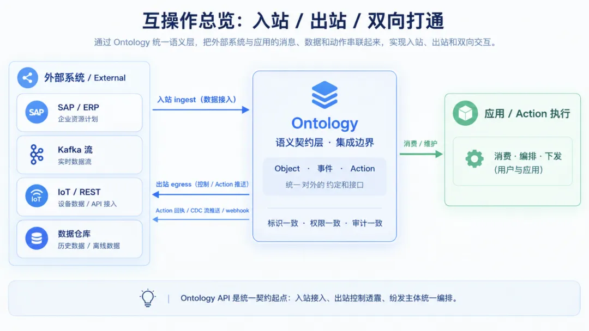
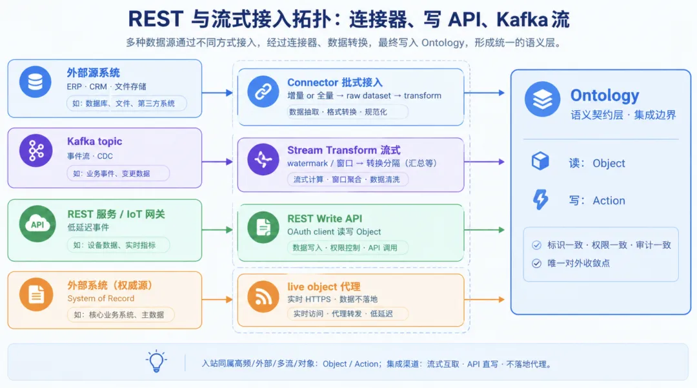
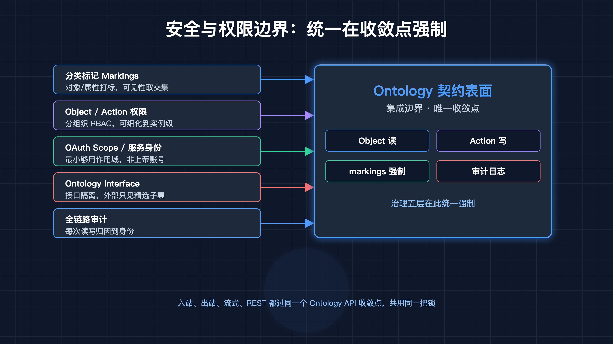
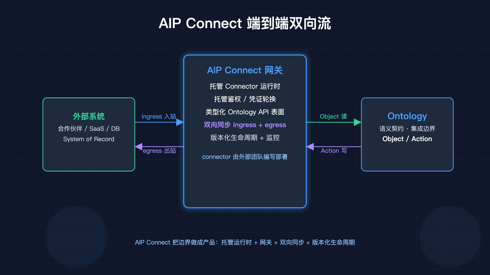

# 互操作性：Palantir 如何与外部世界双向打通

> 来源：[腾讯云开发者社区 · 原文](https://cloud.tencent.com/developer/article/2741858)
> 作者：老周聊架构　|　发布于 2026-09-11 21:07:03
> 说明：全文与配图均按原文保留，配图存于同级 `images/` 目录（`io-01` ~ `io-05`）。原文第二节与第三节之间使用的是同一张接入拓扑图，故 `io-02` 与 `io-03` 内容相同。

---

很多企业上 Palantir，真正卡住的地方从来不是"怎么建 Ontology"，而是"怎么让它和已有的那一堆系统说话"。一个正常的央企或者大型制造企业，背后是 SAP、是几十年累积的 Oracle 库、是 Kafka 上跑着的实时事件流、是四五十个内部 REST 服务、是另一个团队自己搭的数据湖。Palantir 不是来把这些全替换掉的，它是来坐在这些系统的中间，让大家在一个**统一的语义模型**上协作。

所以本篇要讲的本质问题只有一个：Palantir 和外部世界之间的那道**边界**，到底是怎么设计的。数据怎么进来，控制指令怎么出去，外部系统凭什么只需要懂很少的东西就能接入，以及最关键的，跨这道边界的读写谁能做、做多少。

谈边界之前要先说清楚一个**前提**，否则后面所有机制都会讲偏。

把整张图拆开看，互操作的**脊柱**其实只有两个方向：入站（inbound，数据从外部世界流向 Ontology）和出站（outbound，控制与状态从 Ontology 流向外部世界）。所有机制、所有组件，归根结底都只是把这两个方向做得更稳、更快、更可控。下面先讲 Ontology 为什么能当这个边界的"地基"，再分别拆开两条方向，最后落到安全和治理——因为边界一旦跨了信任域，能不能治理比能不能连通重要得多。

## 一、Ontology 是契约，不是数据库

很多人第一次接触 Palantir 会觉得 Ontology 就是"图数据库"。这个理解会让你完全读不懂它的互操作设计。Ontology 真正扮演的角色是一个**类型化的语义契约层**：对内，它把 Foundry 里那些不可变的、底层的 dataset 和 transform 抽象成有业务含义的对象（Object）；对外，它是外部系统唯一能看见、也只需要看见的东西。

内部那一层是这样的：Foundry 把所有数据存成 immutable dataset，再通过 **transform** 计算派生出对象。一个 `Customer` 对象，背后可能是三张源表 join 出来的，可能是昨夜批处理算出来的，也可能是上游某个流任务实时写入的。外部系统完全不需要知道这些。它看到的只是 `Customer` 这个类型、它的属性、以及能对它施加的操作（Action）。

这正是这个设计最值钱的地方：**Ontology 是一层稳定的接口**。底层 dataset 改了 schema、transform 重写了逻辑、存储从 S3 迁到别处，只要 `Customer` 这个对象类型和它的属性还在，外部消费者就不受影响。这和"给裸文件套一层数据库 schema"是同一类解耦，只不过它发生在企业语义层面，并且跨越了多个异构系统。

对象还有两种形态，理解这一点对讲明白互操作至关重要。

一类是**物化对象（materialized object）**：数据真的落在 Foundry 里，由 transform 从 dataset 计算出来。

另一类是**实时对象（live / service-backed object）**：数据根本不进 Foundry。当你去读这个对象时，Foundry 会实时调你提供的一个外部 HTTPS 端点（或 Function），把当前值取回来。换句话说，Ontology 在这里变成了架设在外部系统之上的一层虚拟化**层**——系统还是系统，数据还是待在原地，Palantir 只是按需代理它。

这一条是 Palantir 互操作里最深的原语。它回答了一个现实问题：有些系统的记录你是绝对不想复制一份的（比如交易核心、主数据），但你又想让它在 Ontology 上可以被关联、被查询、被编排。**Live object** 让这件事不需要 ETL 落地就能实现。

写的那一侧，靠的是 Action。Action 不是一句自由的 SQL，而是一个**带 schema、带校验逻辑、带执行路径的类型化操作**。它在契约层明确定义了三件事：需要哪些参数（必填还是选填）、执行前必须满足哪些前置条件（precondition）、以及执行后会改动哪些对象。对外部代码或用户来说，改变 Ontology 状态的唯一合法方式就是 apply 一个 Action。这个 apply 是原子的、服务端校验的、并且被审计记录的——你不可能绕过校验直接改写底层 dataset，因为底层存储根本不在你的可达范围内。

把读和写合起来看，Ontology 作为**契约**的含义就完整了：外部系统面对的不是一个数据库，而是一个有明确定义类型、明确权限、明确变更语义的"接口"。内部数据怎么存、怎么算，对外部完全透明；外部只需要知道对象长什么样、能施加什么操作。

## 二、入站：让外部世界的数据进来

**入站（ingest）**有四条不同的机制，它们解决的是不同延迟、不同保真度、不同拷贝策略的问题。不要把它们混为一谈。

第一条是 **Connector（批式连接器）**。Foundry Connectors 是一整套源系统适配器：JDBC 数据库、S3/GCS/Azure Blob、REST 端点、ERP（SAP、Oracle）、SaaS（Salesforce、ServiceNow）。它们按调度或事件去把数据拉进来，落地成原始 dataset，再交给 transform 物化成对象。Connector 替你扛掉了那些真正脏的活：分页、鉴权刷新、限流、schema drift 的探测。你写的是配置，不是胶水代码。更关键的是，Connector 支持全量快照（snapshot）和**增量同步（incremental sync）**两种模式——它会在内部维护一个**水位线（watermark）**来记住上次拉到了哪里，只拉增量，而不是每次全量重跑。落地的原始 dataset 是不可变、带版本的，所以每一次同步都可回溯。市面上绝大多数"把历史系统数据接进来"的需求走的都是这条路。当你需要的源系统不在官方目录里，还可以用 Connector SDK 自己写一个，模式完全一样。

第二条是 **REST 写 API（Ontology Write / Object Storage API）**。当批调度满足不了延迟要求时，你可以直接通过 HTTPS 创建、更新、删除对象。典型形态是 `POST /api/v2/ontologies/{ontology}/objects/{objectType}` 这类端点。它适合事件驱动、低延迟的入站——比如一个 IoT 网关每毫秒吐一条读数，你不想等下一个批窗口。和 Connector 走"先落 dataset 再物化"不同，写 API 直接作用于对象语义层：你传的是对象的属性，平台负责把它落到正确的 backing store。对象写进去之后，下游的 live object 订阅、流式订阅会即时反应。外部系统拿到的身份是一个 OAuth client，用 client-credentials 换成 bearer token 再调，全程没有用户名密码落地。

第三条是 **Kafka 流式接入**。Foundry 有流式 ingest：一个 connector 从 Kafka topic 消费消息，跑一个 stream transform，消息一到达就把对象物化出来。这是把新鲜度压到亚秒级的办法。stream transform 和批 transform 的区别在于它要处理乱序和窗口（watermark），保证在事件迟到的情况下对象状态仍然收敛。注意这里出现了一个对称关系：Kafka 既能把数据送进来（作为 source topic），也能把 Ontology 的对象变更送出去（作为 sink topic，CDC 形态）——每当一个对象被创建/更新/删除，对应 topic 就收到一条消息。后半句属于出站，下面再讲。

第四条就是上面说的 **live object 代理**：读的时候才出去取，数据物理上从不进入 Foundry。这里的"出去取"不是随便一个 SQL，而是你托管的一个标准 HTTPS 端点：Ontology 拿着对象主键和调用上下文请求它，它返回该对象的属性集合，平台再据此做缓存和权限裁剪。这意味着那套系统仍然是数据的权威来源（system of record），Palantir 只是它的一个读视图，原始数据一处更新、处处一致。

你会发现一个统一规律：Connector 和流式通常意味着"把数据拷进来"（因为你想在它上面做 enriched、做计算）；live object 意味着"不拷"（因为那是你不愿搬动的系统记录）。两者对外呈现的都是 Ontology 表面，对 Palantir 应用来说没有区别。我习惯用两个维度去给这四条机制归类：横轴是延迟（批式小时级 vs 流式亚秒级 vs 实时代理按需），纵轴是**拷贝策略**（落地物化 vs 不落地虚拟化）。落到哪个象限，决定了你该选哪条路——没有一条机制能同时最优地覆盖所有象限，所以 Palantir 才把它们都提供出来，而不是做一个"万能入站"。

## 三、出站：让控制和状态出去

边界的另一半是**出站（egress / action）**。很多企业部署 Palantir 的终极目的不是看[报表](https://cloud.tencent.com/product/bi)，而是**让它真的去指挥外部系统做事**。

第一种模式是 **带外部副作用的 Action**。当你 apply 一个 Action，它的逻辑里可以挂一个 Function（部署在 Ontology 里的类型化计算），这个 Function 去调一个外部 HTTPS 端点。举个具体的例子：`DispatchWorkOrder`（派发工单）这个 Action，应用之后会触发对现场服务系统的一次调用，把工单真正下发出去。Action 也可以被配置成写到一个外部 dataset 或 topic。核心点在于：写操作并不停在 Ontology 这一层，它可以作为受治理的副作用跨越边界传播出去。这里"受治理"三个字很重——这次出站调用同样受 markings 约束，你不会因为调了一个 Action 就越权把一份读不到的数据推到外部去；而且调用是幂等设计的，网络重试不会造成重复派单。

第二种模式是 **向流和 topic 出站**。Foundry 可以把对象变更推到 Kafka sink topic，通过反向 connector 推回外部数据库，也可以直接打 webhook 通知第三方。一个 Action 的执行过程本身就能 emit 事件，触发下游一堆系统的连锁反应。对于文件类的对象（比如一份 PDF 检验报告），还有专门的 Media 通道把二进制安全地外发。这就是 Palantir "作用"于外部世界、并让其它系统保持同步的方式——它不是单向的数据黑洞，而是闭环里的主动一方。

所以入站/出站的划分可以收口成一句话：**数据通过 connector、REST、流式、live object 流进来；控制和状态变更通过 Action（带副作用）与出站流流向外部**。

## 四、AIP Connect：把边界本身变成产品

上面这些机制单独看都是能力。但如果没有一层把它们组织起来，一个企业里的互操作就会退化成一堆无人维护的胶水脚本和散落的 Function。**AIP Connect** 就是来填这个坑的。它最早是从"把 Ontology SDK 跑在 Foundry 之外"的思路演进而来：与其让合作伙伴为了接你而把整套 Foundry 搬进自己机房，不如给他们一个受控的网关，代码在边界外跑、数据在边界内收。把它和前面几节串起来看，AIP Connect 实际上一次性回答了三个问题：连接（怎么连上外部系统）、身份（以谁的身份连）、生命周期（这个连接怎么版本化和监控）。

AIP Connect 是一套**托管式的连接器运行时（managed connector runtime）**。所谓 connector，是一段集成代码（用官方 SDK 写），它作为你 AIP/Foundry 部署的一部分运行，但由外部系统的拥有团队独立编写和部署。它给你几样关键的东西：

- 托管的鉴权与凭证管理。connector 代码里不再硬编码任何密码或 token，所有调用都可归因到具体的身份。凭证轮换、secret 存储都由平台接管。
- 类型化的 Ontology API 表面。connector 用同一套 Ontology SDK 去读对象、写对象、apply Action。这意味着它自动受到 marking 和权限的约束——你写一个 connector 不需要自己再去想"这个人能不能看这份数据"。
- 双向同步。一个 connector 可以同时从一个外部系统入站、又向它出站，保持 Ontology 和系统记录的一致性。这才是"双向打通"的真正载体，而不是两个各跑各的批任务。
- 生命周期治理。版本化的部署、健康度监控、部署即可见。你部署的就是跑起来的，没有"测试环境能跑生产环境玄学"的问题。

在 AIP Connect 之前，深度的外部集成往往是 bespoke 的 Function 或外部脚本直接打 API。AIP Connect 把这些零散做法收敛成一个可观测、可治理的模式。它的本质就是一句话：**把"边界"做成了产品**。你面对外部系统的那一圈复杂对接，是有运行时、有身份、有版本、有监控的，而不是几段散落在各处的脚本。更具体地说，AIP Connect 区分了入站连接（ingress，外部系统主动来读/写 Ontology）和出站连接（egress，Ontology 主动去摸外部系统）两种拓扑，并且一个 connector 部署（deployment）可以声明自己同时具备两者——这正是"**双向打通**"在工程上的落点。

## 五、安全与治理边界：这才是互操作的真正难点

前面所有机制，如果边界不受**治理**，就一文不值。因为互操作的全部意义就在于它跨信任域。Palantir 在这道边界上建立了一套分层模型，我按从外到内的顺序讲。

**第一层是分类标记（markings）**。每个对象和每个属性都可以携带分类标记——而且标记是可以组合的，比如"内部"叠加"需知会"再叠加某个项目代号，对象实际可见性由所有标记的交集决定。一个 connector 或服务身份，只能读到它被授权清空的标记级别的对象。关键是这套标记施加在 Ontology 层，所以它自动保护批式、流式、REST 三种入站通道，也保护出站——你没法把一份读不到的数据通过 Action 推到外面去。你不可能"在 connector 里忘记做权限检查"，因为 connector 走的是 Ontology API，标记在那里被集中强制，而不是散落在每个连接器自己的代码里。

**第二层是对象类型与 Action 的权限**。Ontology 声明了谁可以读哪种对象类型、谁可以 apply 哪个 Action。权限是分组织的、基于角色的：你把一个 role 授权给某个 group，这个 group 里的身份就拥有对应的读/写/执行能力。一个下游消费者，凭据是对的，但缺了权限，拿到的结果就是空或者拒绝。更进一步，权限还能细化到对象实例级别——通过 type class / entity metadata 给某个具体对象实例打标签，规定"只有华东区的人才能看华东区的设备"，这是类型级权限之下的第二道闸门。写也同理：没有写权限的对象类型，你根本写不进去。

**第三层是 OAuth scope 与服务身份**。外部系统以一个 Foundry OAuth client（或用户凭据）的身份鉴权，通常用 client-credentials grant 换取短期 bearer token。授权范围（scope）决定了它能接触的表面：哪个 Ontology、哪些对象集、哪些 Action。对于机密性高的场景用 confidential client，token 不暴露在端上；轻量场景可以用 public client。所以"一个合作伙伴集成"是一个**有作用域的身份**，而不是一个上帝账号。这是避免"接一个系统就得给一把万能钥匙"的关键设计——每个外部对接拿到的都是最小够用的那把钥匙。

**第四层是 Ontology Interface 作为契约表面**。与其把整个 Ontology 敞开门，你可以发布一个 Ontology Interface——它本质上是一个接口类型（interface type），由具体的对象类型去"实现"。你挑出特定对象类型加上特定 Action，组成一个精选过的、类型化的子集，作为给合作伙伴的契约。合作伙伴对着 interface 写代码，它根本感知不到底层还有哪些对象类型；内部那些不破坏 interface 的改动，对它是完全不可见的。在跨企业数据空间（cross-realm / shared ontology）的场景里，这套机制还能让你和合作伙伴共享一个受限的 Ontology 视图而不暴露自家全部数据。这本质上就是接口隔离原则（ISP）在企业集成层面的应用：你给外部看的，永远只是它该看的那一点。

**第五层是审计**。每一次跨边界的读和写，都可归因到身份并被记录——哪个 OAuth client 在何时读了哪个对象、apply 了哪个 Action、推了什么到外部系统，全链路有迹可循。在受监管行业，这一条几乎是整个互操作能不能落地的决定因素。没有归因，就没有合规；而因为所有流量都走过 Ontology API 这唯一的收敛点，审计日志天然是完整且一致的，不需要去十几个连接器里分别捞日志再拼起来。

把这些层叠起来，正确的心智模型是：**Ontology 是一道带类型化、版本化 API 的防火墙**。入站流量穿过 ingest 机制，最终都汇入 Ontology；出站流量穿过 Action 与 egress，都从 Ontology 起源。Ontology API 是唯一的**收敛点**（choke point），markings、权限、审计都在这里被一致地强制。这就是为什么 Palantir 能"互操作"却不会退化成"一个不受治理的巨大 ETL 乱麻"。

## 六、为什么非要这么绕

最后说一下 Why，不然容易觉得 Palantir 把简单事情搞复杂了。

替代方案是：让每个外部系统直接读裸 dataset、直接写裸 dataset。这件事短期看最快，但长期有三个必爆的雷。其一，失去治理——权限和标记没法在裸数据层一致地强制，尤其在流和批混合的场景。其二，失去 schema 稳定性——源系统改一个字段，下游十个消费者全挂。其三，是集成复杂度爆炸：N 个源系统对 M 个消费者，就是 N×M 个点对点对接。

通过强制一切穿过 Ontology 契约，Palantir 把 **N×M** 的点对点，收敛成"N 个 connector + M 个消费者，全部对着同一个稳定接口"。互操作性不是"能连"，是"连了之后仍然可控、可演进、可审计"。这道题的优雅之处，全在边界那一层的设计里。

我用一个制造企业的具体例子把整条链路串一遍。SAP 里的物料主数据通过 Connector 增量同步进 Ontology，成为物化对象；产线上的 IoT 传感器读数走 Kafka 流式接入，亚秒级刷新设备对象状态；ERP 里的在制工单则用 live object 代理，保持 ERP 是权威来源、数据不落地。当运营同学在 Palantir 上对一个异常设备 apply 了 `DispatchWorkOrder` 这个 Action，Action 背后的 Function 调现场服务系统的端点把工单派出去，同时 CDC topic 把这次状态变更同步给仓库 WMS，仓库据此备料。整条链路里，SAP 团队、IoT 团队、现场服务团队、仓库系统各自只对着 Ontology 的 **Object 和 Action** 写代码，谁也没碰过别人的内部存储。这就是"互操作性"三个字落到一个真实工厂里应有的样子。

