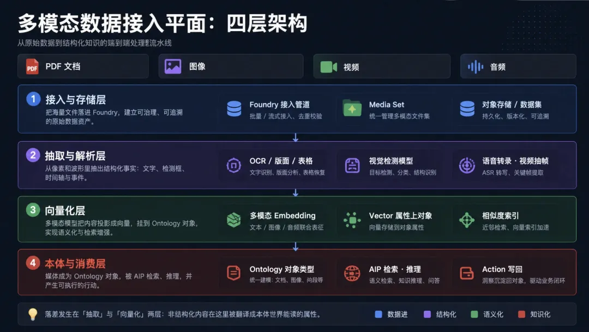
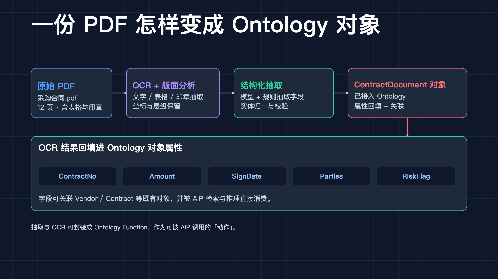
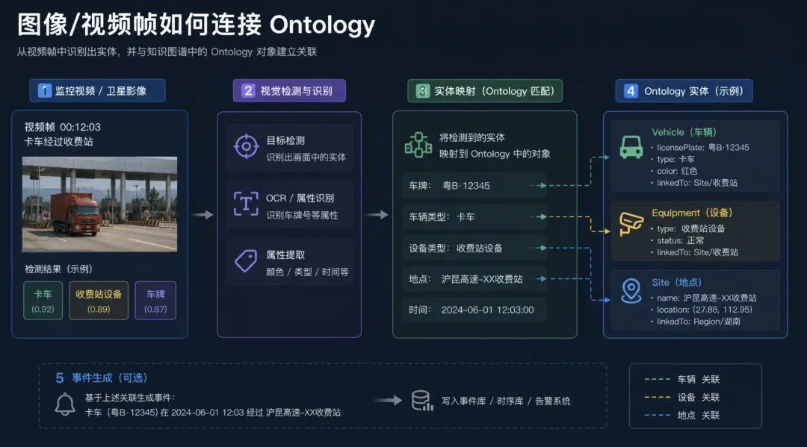
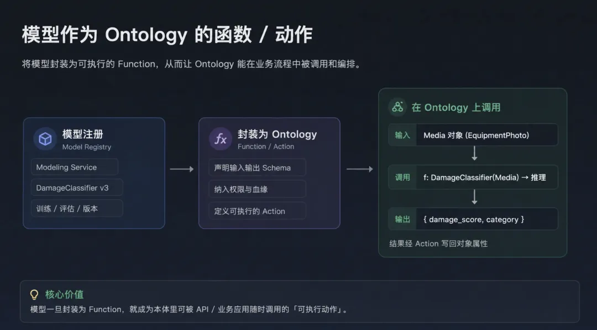
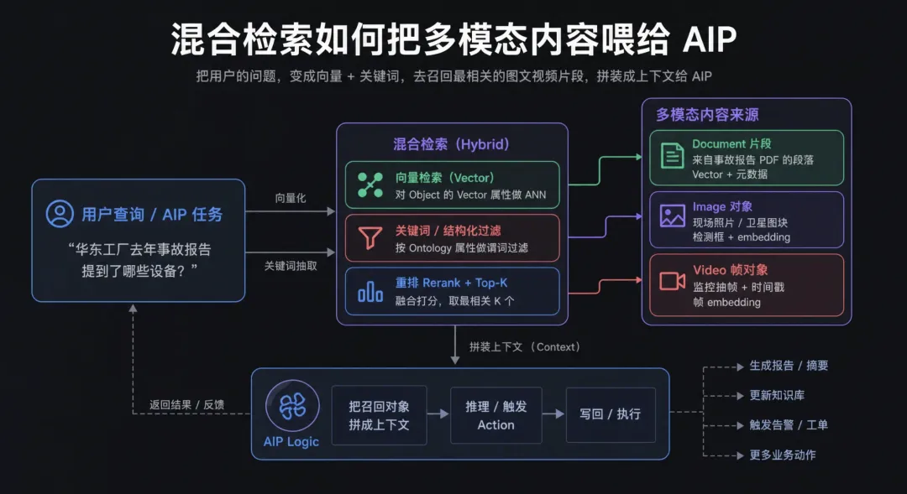

# 多模态数据平面：让 PDF、图像、视频进入 Ontology

> 来源：[腾讯云开发者社区 · 原文](https://cloud.tencent.com/developer/article/2739441)
> 作者：老周聊架构　|　发布于 2026-09-08 20:48:37
> 说明：全文与配图均按原文保留，配图存于同级 `images/` 目录（`mm-01` ~ `mm-05`）。

---

企业里绝大多数信息从不住在数据库表里。合同是 PDF，现场是图像，车间是视频，调度录音是音频。业务真正发生的地方，恰恰是被我们轻描淡写称作"非结构化数据"的那一堆文件。但多数公司的"操作系统"——不管是自研中台还是 Palantir 那样的本体系统——第一反应还是先把数据塞进关系表，能用 SQL 或 GraphQL 查到才算"接入"。结果常常是：结构化主数据建得很漂亮，真正承载业务语义的非结构化内容，全堆在对象存储里吃灰。

Palantir 有意思的地方在于，它没有把非结构化数据当成"等哪天有空再处理"的杂物，而是从架构第一天起就把文档、图像、视频、音频当成一等公民。它们能成为 Ontology 里的对象类型（Object Type），能和订单、设备、人员互相链接，能被模型推理，也能被 AIP 直接检索、直接驱动动作。这套能力我把它叫做"**多模态数据平面**"。这篇就把这一层拆开，看它到底怎么把一堆文件，变成本体世界里可计算、可治理、可行动的对象。

## 一、本质矛盾：本体要的是"对象"，不是"文件"

要理解 Palantir 为什么这么设计，得先看清一个底层冲突。Ontology 的世界观是高度结构化的：世界由**对象**（Object）组成，每个对象有一组带类型的属性（Property），对象之间通过链接（Link）形成关系网，Agent 和系统通过动作（Action）去改变对象的状态。这套世界观极其适合调度、风控、供应链这类"对象明确、关系明确"的场景。

但一封合同、一段监控视频，天然不是"对象"。它们是连续介质：你没法用一行属性和几个外键去穷尽一份 PDF 的全部含义，也没法把一段 30 秒的视频直接挂成"设备 A 发生了故障"这样一个对象。文件是承载信息的容器，对象才是可计算、可推理、可治理的单元。多数系统的做法是把文件丢进一个"附件"字段，然后假装它接入了系统。Palantir 的做法相反：它要在文件这个容器上，长出真正能被本体消费的对象结构。

我的看法是，这里的关键判断是——非结构化数据接入本体的本质，不是"存储"，是**"翻译"**。把文件从一种不可计算的介质，翻译成一组带类型、可链接、可检索的对象。翻译发生的地方，就是这个多模态数据平面。它底下分四层，我后面逐层展开。

## 二、四层平面：把非结构化流量驯服

第一张图给了总览。从最底层的原始媒体，到最上层的 AIP 消费，中间隔着四层，每一层都在干一件确定的事。

**接入与存储层** 负责把散落在各处的文件收拢进 Foundry，形成可治理的媒体底座。这里的核心概念是 **Media Set**（媒体集）：它是一种 Foundry 里的一等数据集类型，专门存二进制媒体（图像、视频、音频、PDF）以及它们的元数据。Media Set 的意义不只是"有个地方放文件"，而在于它把媒体纳入了 Foundry 的血缘、权限、版本和调度体系——一份上传的 PDF 从此不是对象存储里一个孤立的 blob，而是有来源、有治理、可回溯的数据资产。

**抽取与解析层** 是翻译真正开始的地方。对文档跑 **OCR** 加版面分析，抽出文字、表格、印章、层级结构；对图像和视频跑视觉模型，得到检测框、分割掩码、属性；对音频跑语音转录，得到带时间戳的文本；对视频还要先做抽帧，把时间轴切成可处理的帧序列。这一层的产出不是"又多了一份解析结果"，而是一组结构化的事实：文字段落、坐标框、时间戳、置信度。

**向量化层** 负责把上述内容投影成多模态模型能理解的**向量**空间。OCR 出来的文本、视觉模型抽到的特征、音频转录，都可以被多模态 embedding 模型编码成一个向量，挂到对应对象的属性上。这一步是把"语义"变成可计算距离的关键：从此"找相似的图""找相关的段落"不再是关键词匹配，而是向量空间里的近邻搜索。

**本体与消费层** 是落点。前面三层的所有产物，最终都收敛成 Ontology 里的**对象类型**——Document、Image、Video、Audio，以及它们衍生的子对象——并被 AIP 检索、推理，经 Action 写回。到这里，一份 PDF 不再是一份 PDF，而是一个有属性、有链接、能被动检索也能主动被推理的本体居民。

落差就发生在"抽取"和"向量化"这两层。一层没做好，文件就还是文件；两层都做对了，文件就进了本体。

这里值得停下来想一个问题：为什么非要 Media Set 这种 Foundry 原生类型，而不是直接把文件丢进 S3 再写个解析服务？答案是**治理**。文件一旦进 Media Set，就自动接入 Foundry 的血缘图：这份 PDF 是哪个管道在什么时候导入的、被哪次 OCR 跑过、产出的字段又喂给了哪些下游对象，全部可被追溯。权限也统一了——谁能读这份媒体、谁能触发它的解析，和读一张表走的是同一套策略引擎。很多企业做多模态失败，不是模型不行，而是媒体从导入起就脱离了数据平台的治理，后面所有"智能"都建立在一个没人负责、不可追溯的桶之上。Palantir 把媒体拉进 Foundry 的治理边界，是这套平面能成立的前提。

## 三、文档入本体：一份 PDF 怎样变成对象属性

先拿最常见的 PDF 说事。看第二张图，一条很直的链路：原始 PDF 进来，经过 OCR 加版面分析，再经**结构化抽取**，关键字段回填到 ContractDocument 这样的对象属性里，并关联到其他既有对象。

具体机制要分两块看。第一块是解析。Foundry 的文档处理不会对 PDF 做"整篇转文字"这么粗糙的事，而是保留版面结构去做 OCR：文字层抽取、表格识别、印章与签名检测、坐标与阅读顺序的保留，一并产出。这意味着系统知道"这一段文字在第 3 页右上角、属于表格第二行"，而不仅仅是"有这些字"。这种带坐标、带层级的抽取结果，是后面做精确回填的前提。

第二块是**对象化回填**。解析出来的结构化字段，不会停在某个数据集里等人来查，而是直接写回到 Ontology 对象的属性上。比如一份采购合同，抽取出 ContractNo、Amount、SignDate、Parties、RiskFlag，这些字段成为 ContractDocument 对象的属性；更进一步，合同里识别出的供应商名称，会被归一后链接到已经存在的 Vendor 对象，识别出关联的合同会被链接到 Contract 对象。注意这一步的质变：信息从"文档里的一段文字"变成了"对象的一个类型化属性 + 一条指向其他对象的链接"。

这种对象化的回报是连锁的。一旦合同成了对象，它就自动继承了 Ontology 的**权限模型**——谁能看这份合同、谁能改它的状态，和看设备、看订单走同一套规则。它也继承了血缘：哪个管道抽出了这个字段、哪次模型跑出了这个 RiskFlag，全程可追溯。它还能被 AIP 直接消费：一句"上季度所有高风险供应商的合同金额合计多少"，本质就是一条对 ContractDocument 对象及其链接的聚合查询，不需要有人去翻 PDF。

多说一句工程上的事。文档抽取本身，在 Palantir 里也可以封装成一个 **Ontology Function**——输入是文档对象，输出是结构化字段，过程受权限和血缘约束。这点是后面第五节能看到的"模型即动作"的一个实例：连 OCR 抽取这条流水线，都是本体里一个可调用、可治理的操作，而不是某个散落在 notebook 里的脚本。

还要补充的是，对象化的粒度可以比"一份合同"更细。一份 ContractDocument 不只是自己挂着几个字段，它还能向下派生出 Clause（条款）、Table（表格）、Entity（抽取出的实体）这些子对象，彼此通过链接咬合。这样一来，"合同里哪一条款说了交付周期是 30 天"会变成一个可独立检索、可独立链接的对象，而不是埋在 PDF 文本里的一句话。真正面向检索使用时，这些细粒度子对象才是被向量化、被召回的最小单元。也就是说，对象化的深度，直接决定了后面 AIP 检索能精确到的**粒度**。

## 四、图像与视频入本体：检测框即对象，帧即链接

文档还能靠文字落进属性，图像和视频更"野"——它们没有天然可读的结构，全靠**视觉模型**去发现。第三张图走的是监控视频或卫星影像的链路。

视频比图像多一个预处理动作：**抽帧**。一段视频不能整体送进视觉模型，得先按固定间隔或关键帧策略切成一帧帧图像，每一帧变成一个可独立处理的单元。然后再在帧上跑目标检测、实例分割、车牌 OCR、属性识别，得到带类别与坐标的检测框。

关键点在于：每一个**检测框**，都不该只是"图上有个框"就完了。Palantir 的做法是让检测框直接生成对应的 Ontology 对象。图上识别出一辆卡车，就实例化一个 Vehicle 对象，挂上 licensePlate、make、color 这些属性；识别出一个人，就实例化 Person 对象；识别出设备，就实例化 Equipment 对象。这些对象不是孤立的——它们通过"同属一个 DetectionEvent"关联到一起，又各自通过链接指向它们所属的 Site 或 Location 对象。

这套机制的价值，只有放到"对象"视角才看得清。一个孤立的检测框，过一天就被新的帧淹没了，对业务毫无意义。但一个 Vehicle 对象，能和历史里所有出现过的同一车牌聚合，能和这个人、这台设备在同一事件里被关联，能在事后被"某园区上周出现的红色卡车"这样的查询精确捞出来。视频时间轴被翻译成了**对象关系网**，这才是多模态数据真正"进本体"的含义。

这里还有个值得说的设计取舍：检测结果是流式产生的，但对象链接是持久化的。也就是说，源源不断的视频帧像水一样流过去，沉淀下来的不是帧，而是被本体收纳的对象与链接。流的归流，沉淀的归沉淀，两者通过 DetectionEvent 这样的关联对象衔接。这种**"流处理产出持久对象"**的模式，是视频这类连续介质能被企业系统长期消费的根本原因。

顺带把音频这条线也补上，它和视频是同一个范式。语音或会议录音先经转录模型变成带时间戳的文本，这段文本可以作为一个 Transcript 对象挂到对应的通话 / 会议对象上，文本再被 **embedding** 成向量属性。于是"找出所有提到供应商 X 的客服录音"就变成了一次对 Transcript 对象的混合检索，和检索文档片段没有任何架构上的区别。图像、视频、音频在底层统一为同一件事：连续介质 → 抽取结构化事实 → 落成本体对象 → 带向量属性。差别只在抽取那一步用的是什么模型。embedding 这一步通常会选一个能对齐文本与视觉的模型，这样用户的自然语言查询才能越过模态边界，直接命中一张图或一个视频帧，而不是只能搜文字。

## 五、模型不是外挂，是本体里的"函数 / 动作"

前几节我们一直在说"模型对媒体做了抽取、检测、embedding"。但模型在 Palantir 里的位置，比"被调用一下"要深得多。第四张图说明了一个我认为是整篇最该记住的点：训练好的模型，在架构上就是本体里的一种**"函数 / 动作"**。

机制是这样。模型先在 Modeling Service（模型注册与运行服务）里注册，带着训练版本、评估指标、**输入输出契约**。注册之后，它不会被随便丢给一个 Python 服务去裸调，而是被封装成 Ontology Function 或 Action。封装时你要声明它的输入输出 schema，要说明它作用于哪些对象类型，要纳入权限与血缘体系。封装完成的那一刻，模型就不再是"外部的一个模型"，而是本体里一个可被调用的计算单元。

调用的时候，它就是一个以对象为输入、以结构化结果为输出的函数。比如一个 DamageClassifier（损伤分类）模型，封装后接收 EquipmentPhoto 这个 Media 对象，推理后输出 { damage_score, category }，这个结果再经 **Action** 写回到对象属性上。对 AIP Logic 或 Agent 来说，调用它就和调用任何其他本体操作没有区别——同样受权限约束，同样有血缘记录，同样能触发后续动作。

我特别想强调这个设计的工程意义。在绝大多数系统里，模型是个"外挂"：一个服务暴露 API，谁都能调，权限靠网关挡一挡，结果写不写得回业务系统全凭自觉。Palantir 把模型塞进 Ontology 的动作体系，等于强制它接受和业务流程同等的**治理**：你这个模型能碰哪些对象、产出的结果写到哪里、谁有权触发它，全部被框死在本体约束里。模型自由越大越危险，而把它关进本体的笼子里，它就既聪明又可控。这和 AIP 让大模型只能在本体边界内行动，是同一个底层逻辑。

## 六、检索喂给 AIP：hybrid search 把多模态内容拼进上下文

前面四层解决的是"媒体变成对象"。最后还差一步：这些对象怎么被 AIP 的推理真正用到。第五张图是这一环。

AIP（尤其是 AIP Logic 和基于本体的检索模式）回答一个问题时，不会直接把所有文档扔给大模型。它会先把查询本身向量化，然后做**混合检索（Hybrid Search）**：一边在对象带有的 Vector 属性上做近似最近邻搜索，找回语义相近的文档片段、图像、视频帧；一边按 Ontology 的结构化属性做谓词过滤，比如"时间在过去一年""地点属于华东工厂""对象类型是事故报告"。两路结果融合、重排，取最相关的 K 个，才拼成上下文喂给 LLM。

这里有两个值得抠的细节。第一，被检索的最小单元不是"文件"，是"**对象及其向量属性**"。一份事故报告 PDF 被切成了若干 Document 片段对象，每个都有 embedding，所以检索能精确到"报告里讲设备 X 的那一段"，而不是把整份 PDF 塞进上下文。图像、视频帧同理——召回的是带 embedding 的具体帧或图块，而不是整个媒体文件。

第二，结构化过滤和向量搜索不是二选一，是叠加的。纯向量检索容易召回"语义像但业务不对"的内容，纯关键词过滤又抓不到"说法不同但意思一样"的内容。把 Ontology 的**强类型属性**（时间、地点、类型、状态）当成硬过滤条件压在向量检索之上，召回既准又有边界。这也是为什么非结构化内容必须先"对象化"——只有成了带类型属性的对象，才能被这种混合检索精确命中。

还有两个工程细节值得点出。一是检索本身也是有权限的：用户能召回哪些媒体对象，取决于他在 Ontology 里的读权限，一份他无权看到的合同不会出现在召回结果里。这把"**数据权限**"从应用层下沉到了检索层，省掉了大量"先召回再过滤"的尴尬。二是**重排**不是可有可无。向量近邻和结构化过滤各给出一沓候选，重排阶段会把"语义相关性"和"业务约束满足度"融合打分，再截 Top-K；这一步直接决定喂给 LLM 的上下文质量。召回得再多，重排没做好，上下文一样会被噪声淹没。做好重排，AIP 的回答才会稳。

召回的 K 个对象最终被序列化成上下文，LLM 在 Ontology 的约束内做推理，给出答案或触发某个 Action 写回。到这里，整个**闭环**就通了：一份文件进来，被解析、被抽取、被向量化、成为对象、被混合检索召回、被模型推理、结果再写回对象。媒体从"不可计算的介质"走完了"可计算、可行动"的全程。

## 七、我的看法

把这一篇收一下。Palantir 处理多模态数据的思路，骨子里是一条主线：任何非结构化内容，只要想让它在本体世界里发挥作用，就必须被**翻译**成带类型、可链接、可检索的对象。Media Set 负责收拢，抽取与向量化负责翻译，Ontology 对象类型负责落地，AIP 的 hybrid 检索负责把它喂回推理。模型本身也被封进本体的函数 / 动作体系，和任何业务操作接受同等治理。

我越来越觉得，国内很多"[知识库](https://cloud.tencent.com/product/lexiang)""文档问答""视觉中台"项目做不下去，问题往往不在于模型不够强，而在于跳过了翻译这层。它们把文件存下来、把向量算出来，却始终没把内容真正变成对象——没有类型、没有链接、没有和既有业务实体挂钩，于是检索只能捞片段，推理只能给建议，永远接不进核心流程。Palantir 的笨功夫在于，它硬是把抽取、对象化、链接、治理这一长串不够性感的事，一层层织进了本体。

对打算做企业多模态系统的团队，我的建议很直接：先别急着上最贵的视觉大模型，先把"媒体如何成为本体对象、抽取字段如何回填、对象如何链接既有实体、检索如何 hybrid"这几件事的设计敲定。模型是锦上添花，那套把文件翻译成对象的平面，才是雪中送炭的**地基**。
